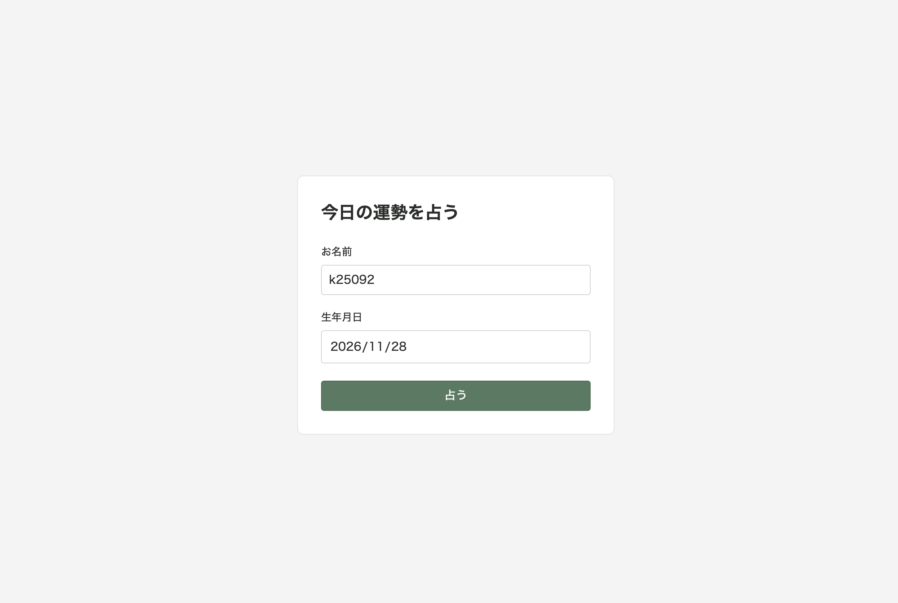
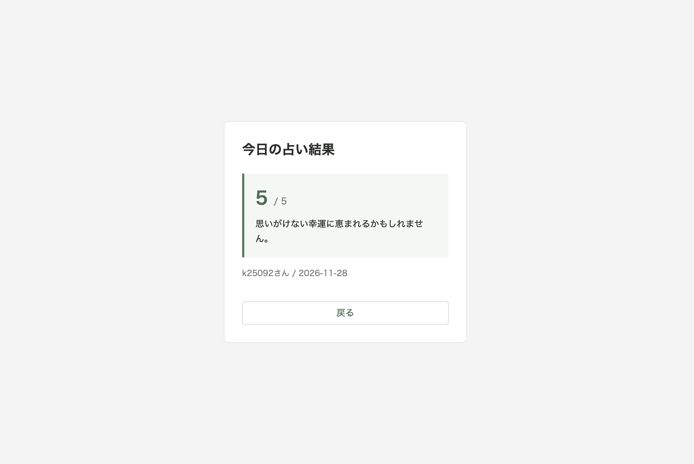

# 第8回個人課題：じゃんけんアプリ&占いアプリ

## 1. 動作確認方法

Python 3 と Flask が必要です。Flask がまだインストールされていない場合は、次のコマンドでインストールしてください。

```bash
python -m pip install Flask
```

プロジェクトのルートディレクトリで、アプリごとに別のターミナルを使って起動します。

### じゃんけんアプリ

```bash
python janken/main.py
```

ブラウザで <http://localhost:8888/> を開きます。ゲーム画面は <http://localhost:8888/janken> です。

### 占いアプリ

```bash
python uranai/main.py
```

ブラウザで <http://localhost:8889/uranai> を開きます。

サーバーを終了するときは、起動したターミナルで `Ctrl+C` を押してください。

## 2. 占いアプリのメッセージ一覧（5段階）


| 運勢ランク | 表示メッセージ |
| :---: | :--- |
| 5 | 思いがけない幸運に恵まれるかもしれません。 |
| 4 | 新しいことに挑戦するとよい流れに乗れそうです。 |
| 3 | これまでの努力が実を結ぶきっかけがありそうです。 |
| 2 | 身近な人との会話に小さな幸運がありそうです。 |
| 1 | 今日は無理をせず、落ち着いて過ごすとよさそうです。 |

名前が未入力、または生年月日が未入力・日付に変換できない場合は、ランクを `1` とし、「入力不備で占えませんでした」と表示する。

## 3. デザイン・実装で工夫したポイント

名前と生年月日を入力して占えるシンプルな画面にした。
結果画面では運勢ランク、メッセージを見やすく表示する。
画面幅が狭い場合にも使いやすいよう、入力欄やボタンの配置を調整している。

### 占い入力画面



### 占い結果画面


